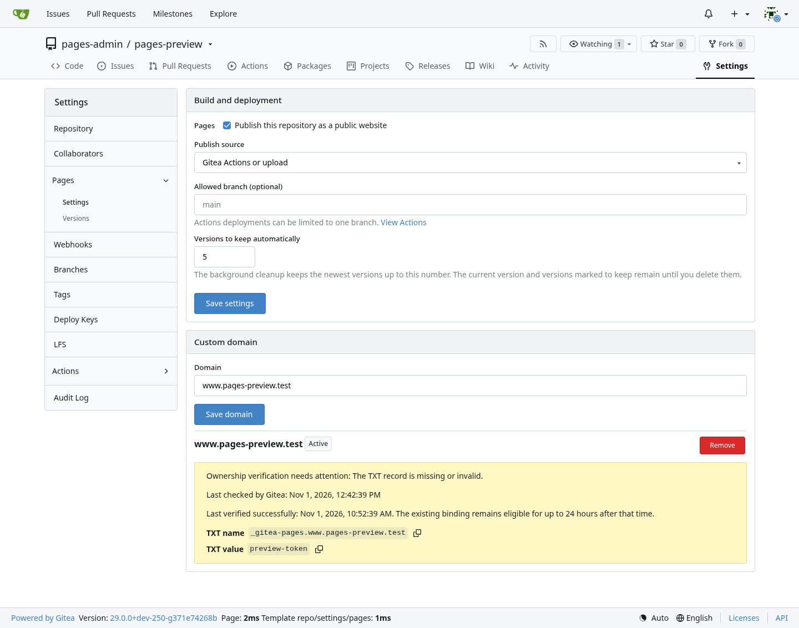
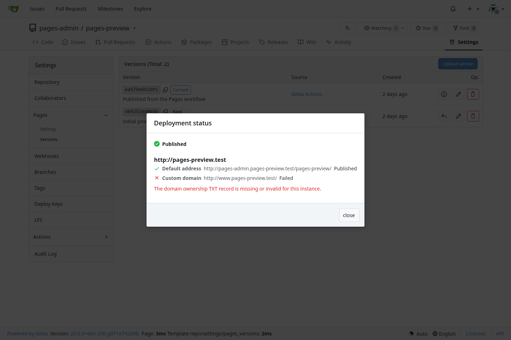
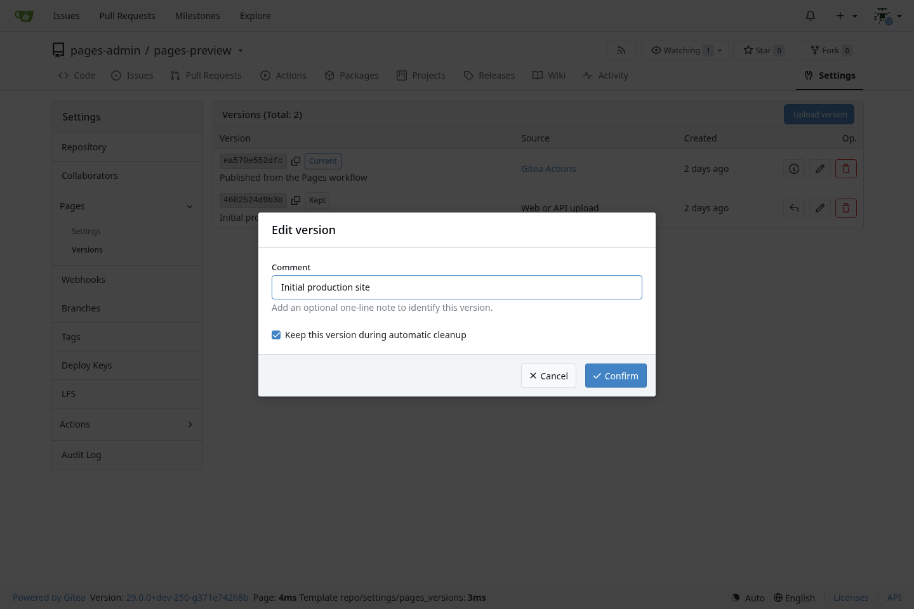
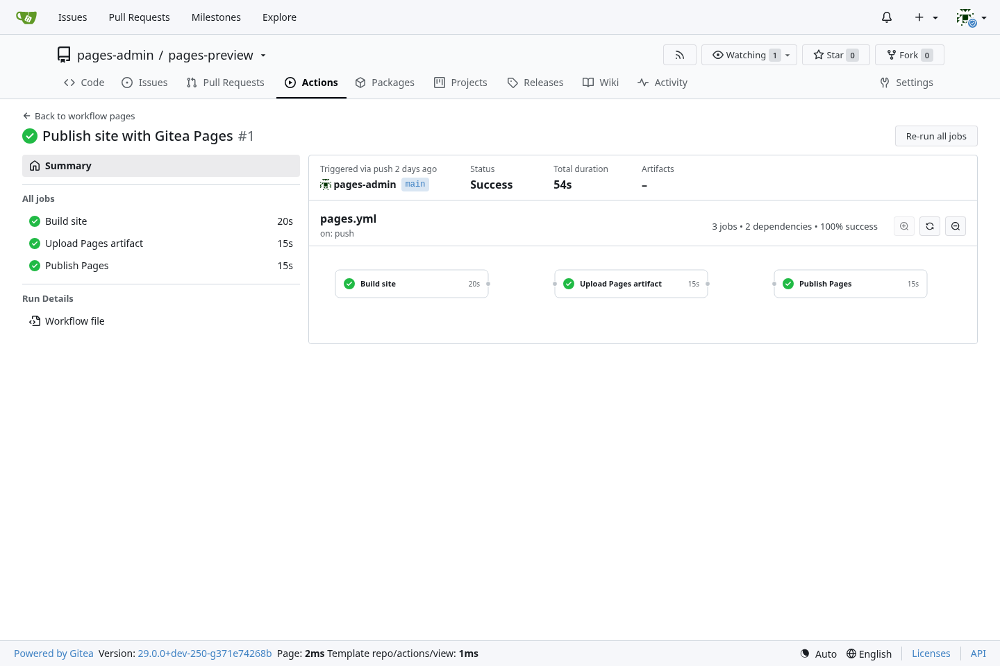
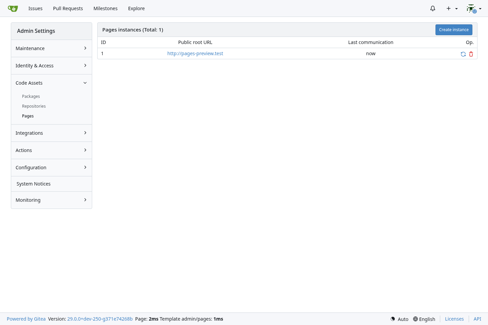

Adds repository Pages backed by the separately deployed [gitea-pages](https://github.com/ExplodingDragon/gitea-pages) service. Gitea manages publishing settings, content versions, domain ownership, registered instances, and deployment results. Keeping the serving process separate lets a site continue serving its last confirmed deployment during a temporary Gitea outage.

Sites can be published from a branch directory, Gitea Actions, or a web/API TAR.GZ upload. Repository administrators can annotate, retain, restore, and delete versions and set automatic retention. Project sites use `https://<owner>.<pages-domain>/<repository>/`; a repository named `.pages` provides the owner site at `https://<owner>.<pages-domain>/`.

Custom domains use TXT ownership verification and expose the deployment result from each Pages instance. Pages sites are public, including sites built from private repositories. Changing a public repository to private disables its site until a repository administrator enables it again.

## Screenshots

Related: https://github.com/go-gitea/gitea/issues/302, https://github.com/go-gitea/gitea/issues/23521, https://github.com/go-gitea/gitea/issues/28907
