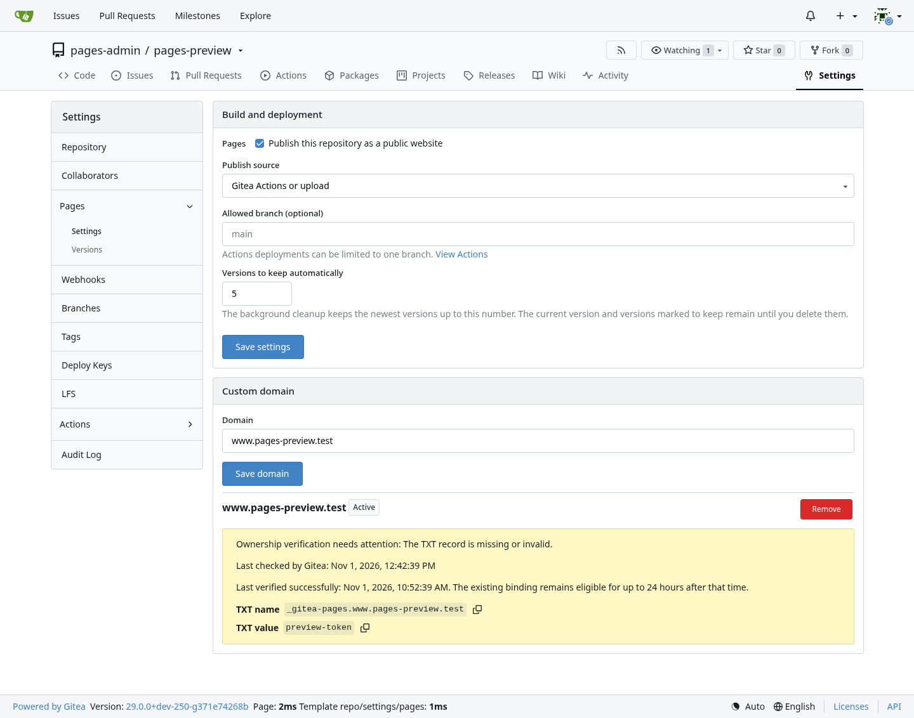
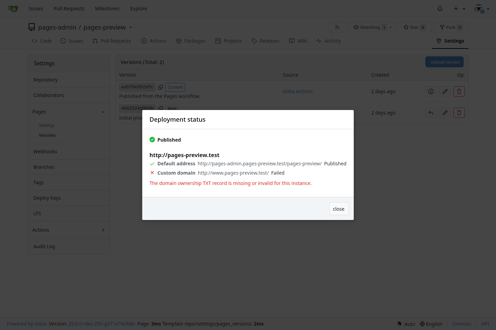
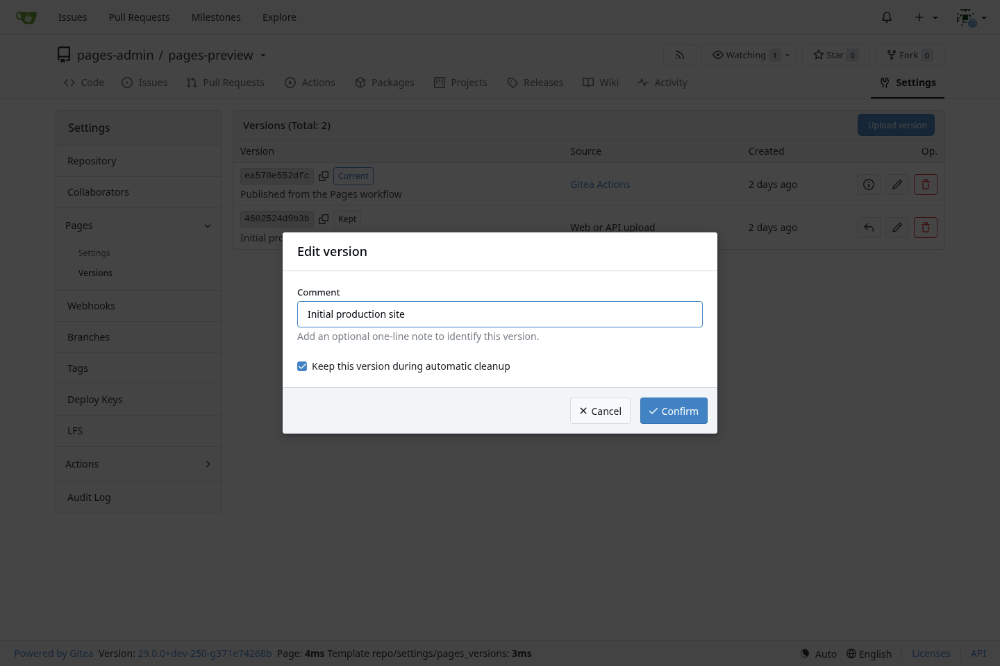
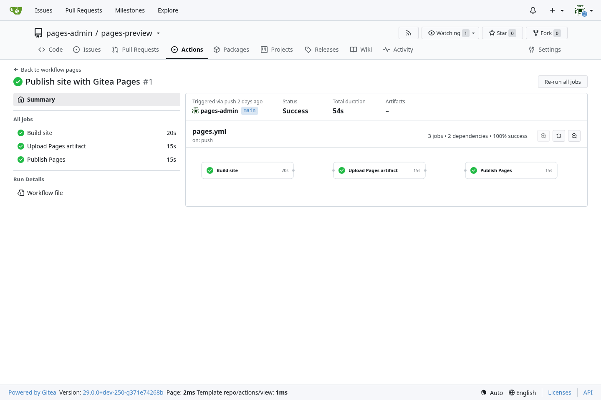
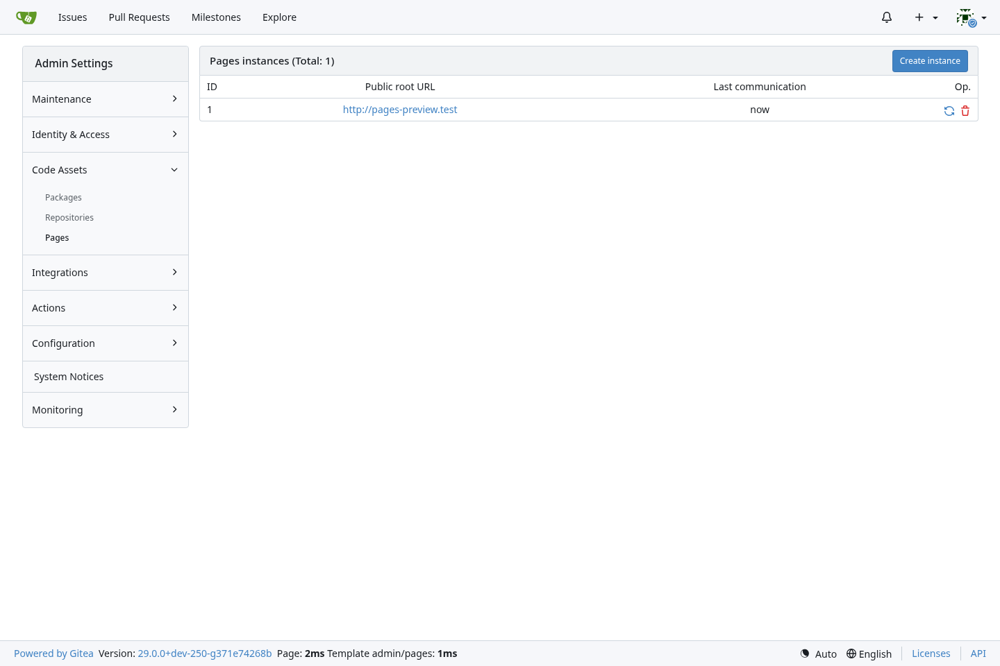

本变更为 Gitea 增加仓库 Pages，并由独立部署的 [gitea-pages](https://github.com/ExplodingDragon/gitea-pages) 服务提供网站。Gitea 管理发布设置、内容版本、域名所有权、已登记实例和部署结果。网站服务与 Gitea 分开运行，因此 Gitea 暂时不可用时仍可继续提供最后一次确认的部署。

网站内容可以来自分支目录、Gitea Actions 或网页/API 上传的 TAR.GZ。仓库管理员可以为版本填写备注、永久保留、恢复和删除版本，并设置自动保留数量。项目站点使用 `https://<所有者>.<Pages 域名>/<仓库>/`；名称为 `.pages` 的仓库提供 `https://<所有者>.<Pages 域名>/` 所有者主页。

自定义域名使用 TXT 所有权校验，并展示各 Pages 实例的部署结果。Pages 网站均可公开访问，包括由私有仓库生成的网站。公开仓库转为私有仓库时，Gitea 会关闭站点，仓库管理员重新启用后才恢复发布。

## 截图

相关内容：https://github.com/go-gitea/gitea/issues/302、https://github.com/go-gitea/gitea/issues/23521、https://github.com/go-gitea/gitea/issues/28907
