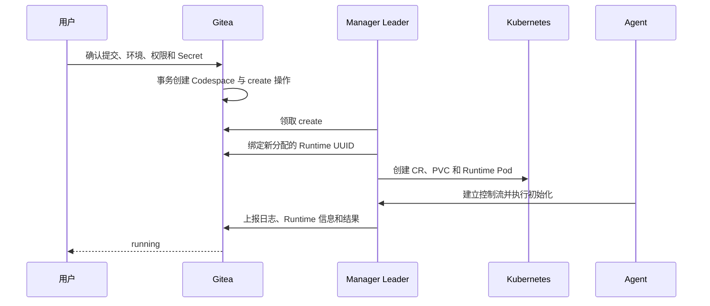

# 生命周期

Gitea 保存用户可见的主状态和当前操作，Manager 负责让 Kubernetes 资源收敛，Agent 负责 Runtime 内的执行。操作版本贯穿三者，使网络重试、进程重启和 Leader 切换不会产生第二条执行链。

## 状态与操作

| 主状态     | 含义                         | 有操作时的类型  |
| ---------- | ---------------------------- | --------------- |
| `creating` | 已确认创建，环境尚未可用     | create          |
| `running`  | Runtime 已就绪               | stop            |
| `stopped`  | 持久数据保留，Runtime 已停止 | resume          |
| `deleting` | 正在确认平台资源清理         | delete          |
| `failed`   | create 已确定无法完成        | 无；允许 delete |

操作创建时间大于零表示存在操作；开始时间为零表示 queued，否则表示 running。操作完成后写入新的主状态并清空触发来源和操作时间。操作类型与阶段由主状态和时间唯一推导，不在数据库中保存第二份相同事实。

每个新意图增加操作版本。领取、续期、日志和最终提交需要匹配 Codespace、Manager、操作类型与当前操作版本。create 或 resume 成功后，Gitea 另行记录建立当前 Runtime 的运行实例版本；running 状态的 Metadata 和 Endpoint 必须匹配该版本。这样 stop 入队后即使当前操作版本已经增加，也不会把旧 Runtime 的 Metadata 错判为新操作结果。数据库写入同时比较读取时的主状态、两个版本和操作阶段，只有仍为当前状态时才生效。delete 可以用更高版本替代进行中的 create、resume 或 stop，因为它代表用户的最终清理意图；其他冲突操作返回当前状态。

用户活动代数独立保护活动递增和自动停止取消，Manager 的操作完成则只比较生命周期快照。这样打开 Endpoint 与 stop 完成并发发生时，活动请求保持环境的既定主状态，stop 也保留已经记录的活动代数。

### 实现验收点

- 一个 Codespace 同时最多有一个有效操作。
- 同一持久行能够唯一推导操作类型和 queued/running 阶段。
- 日志、Runtime 信息和最终结果只接受当前操作版本。
- running 状态的 Runtime 信息只接受持久化的运行实例版本，stop 完成后清零。
- 并发状态写入只有一个能够匹配读取时的生命周期快照。
- 用户活动递增和 Manager 操作完成分别按各自的条件更新生效。
- 重复提交相同意图保持幂等，不增加操作版本。

## 创建

Gitea 先锁定目标提交，再在同一数据库事务中校验用户、仓库、环境标签、Dev Container 配置和授权，并创建 Codespace 与 queued 操作。Manager 领取后分配 Runtime UUID，绑定成功后才创建集群资源。Agent 完成工作区、Dev Container 和访问服务初始化后发布 ready，Manager 再提交 create 结果。Gitea 完成 create 时校验当前运行 Token，并把当前操作版本保存为运行实例版本；Metadata 是可以重建的缓存，因此缓存写入延迟或丢失不会让已经完成的 Runtime 永久卡在 creating。

输入和权限错误在持久化前返回。确定性执行错误进入 failed；可能已经创建的平台资源继续由同一 Runtime UUID 清理，避免重试生成另一套资源。

块卷首次初始化由 Manager 先持久化格式化开始状态，再授权当前 Pod；Agent 完成 ext4 检查和挂载后确认就绪。初始化结果未知时保留数据，避免重复 create 或 Pod 重建把旧数据当成空卷。

### 实现验收点

- 创建确认、授权和任务入队位于同一数据库事务。
- 同一 create 只对应一个 Runtime UUID、一组 CR/PVC 和一个有效操作版本。
- Runtime UUID 绑定前不创建对外可用的 Runtime。
- 页面在 create 完成前可以按偏移读取日志，成功后状态为 running。
- create 完成不依赖展示缓存是否命中，running 后只展示与运行实例版本匹配的 Runtime 信息。
- 格式化授权先于设备写入持久化，同一卷不会因初始化响应丢失获得第二次格式化许可。

## 运行与访问

running 状态下，Agent 向 Manager 发布当前 Pod 身份、访问目标和 Endpoint；Gateway 在每次连接前复核 Gitea 权限并取得短期票据。用户活动更新最后活动时间，用于自动停止；组件心跳和后台状态检查不计为用户活动。

Runtime 信息是可重建的展示数据。暂时失联会让访问入口显示不可用，但不会把 running 推测为 stopped 或 failed。当前操作可能已经是 stop，而 Runtime 信息仍通过运行实例版本指向 stop 前的 create 或 resume；只有 stop 完成后才清除该身份。

### 实现验收点

- 私有 Endpoint、Web IDE、SSH 和 SFTP 均需要当前用户授权。
- 公共 Endpoint 仍需匹配当前 Runtime 和 Endpoint 声明。
- 后台心跳不会延后自动停止。
- Runtime 信息过期不改变主状态。
- 生命周期操作版本变化不会让旧 Runtime 获得新实例身份。

## 停止、恢复与自动停止

stop 定向到已绑定 Manager。Manager 撤销路由和运行期凭据、停止 Runtime Pod 并保留 CR/PVC，确认完成后 Gitea 进入 stopped。resume 复用 Runtime UUID、CR、PVC 和已确定的环境配置，创建具有新 Pod UID、Agent 身份和访问目标版本的 Pod。

首次创建由 init 后进入 start；恢复只执行同一 start 语义。环境标签用于首次调度，后续改名或删除不会迁移已有 Codespace。自动停止通过普通 stop 操作实现，因此具有相同版本、清理和恢复行为。

Manager 通过活动代数判断自动停止设置的新旧，设置同步与自动停止响应采用同一更新规则。较新的用户活动会重新开始空闲观察；重复收到相同设置保留已有空闲计时，延迟到达的旧设置也不会覆盖较新的活动，保证网络重试不改变用户的空闲期限。

### 实现验收点

- stop 后持久数据保留，Runtime Pod、路由和运行期 Token 消失。
- resume 不重新克隆仓库，也不重放初始化或一次性生命周期命令。
- resume 发布新的 Pod 身份、访问目标版本和短期凭据。
- 手动停止与自动停止使用同一状态转换，并发扫描不会创建重复操作。
- 设置更新和自动停止响应均保留较新的活动代数；重复设置保留空闲计时，新的活动重新开始观察。

## 删除

delete 生效后，只有当前 delete 版本可以发布状态。Manager 依次撤销访问、停止执行并删除 Pod、PVC、CR 和路由信息；确认平台资源消失后，Gitea 清理业务关系、凭据、日志和展示数据。

删除步骤以资源身份和稳定名称保持幂等。资源已经不存在表示该步骤完成；资源状态尚未确认时保持 deleting，并由后续协调继续核对。

Gitea 删除 Manager 时立即撤销身份并清理其业务记录，运行平台数据由 Manager 管理员明确处理。管理员先停用站点，再针对当前 CR UID、资源版本和 Pod UID 确认删除；Manager 记录删除意图并沿用上述停止和删除流程。这也为 Gitea 记录已经不存在的环境提供了可审计的清理入口。

### 实现验收点

- create、resume 或 stop 期间发起 delete 最终能够收敛。
- 重复 delete 不会重建资源，也不会因资源已经不存在而失败。
- deleting 只接受当前 delete 版本的操作结果。
- 平台资源确认清理前，业务状态保持可诊断。
- 身份撤销本身保留运行平台数据；停用站点后的显式清理最终删除对应 PVC 和 CR。

## 超时与恢复

create 和 resume 的排队或执行期限用于结束无法启动的请求：create 进入 failed，resume 回到 stopped。stop 和 delete 表达必须完成的收敛意图；执行许可到期后以更高操作版本重新排队，并保留首次创建时间用于诊断。

Manager Leader 接管时先续期仍绑定的操作，再提交完整资源清单并核对 Gitea、CR、PVC、Pod 和 Agent。工作区准备会核对现有仓库提交并重新配置当前凭据，因此崩溃后可以安全继续；任意 Dev Container 生命周期命令仍采用至多一次语义，已持久记录的结果只重复上报，开始后未记录完成则明确失败，因为盲目重放可能重复修改用户环境。旧 Pod 是否仍可能写入 PVC 的处理见[运行平台](runtime-platform.md#高可用与恢复)。

执行许可失效或操作被替换时，Agent 取消命令、停止专属 Docker 并退出当前执行循环。Manager 按旧 Pod 的停止事实决定后续操作能否继续，防止取消 RPC 后容器内命令仍在修改数据。SSH、SFTP 和端口转发的普通断连仅释放对应访问连接，不改变生命周期状态。

操作续租与结果、Metadata 上报使用独立循环，避免慢上报占用续租时间。上报循环先通过本地资源缓存判断是否到达刷新周期或存在待确认结果，实际执行时再读取实时站点、凭据和资源列表。Watch 合并有关配置、身份、目标和结果的变化；单纯的上报代数与启动进度由定期刷新处理，减少无意义的实时读取和路由重建。

### 实现验收点

- create/resume 超时进入明确稳定状态，stop/delete 超时继续收敛。
- 两个 Manager 竞争时只有一个能领取同一操作。
- 新 Leader 不依赖前任进程内状态即可恢复协调。
- 已完成阶段不会重放，结果未知的阶段提供明确诊断。
- 工作区克隆中断后可以从临时目录重新准备，已完成的目标仓库会先核对提交再复用。
- 空闲上报检查只读取本地缓存；有待上报内容时仍以实时身份和资源状态为准，慢上报不阻塞续租。
- 旧操作取消后不在同一 Pod 中启动下一操作；新执行遵守原有旧 Pod 停止确认流程。
