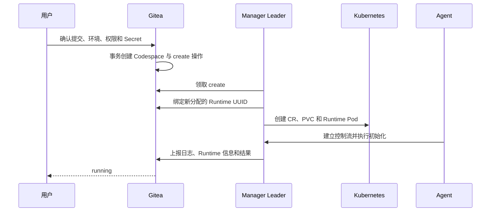

# 生命周期

Gitea 保存用户可见的主状态和当前操作，Manager 负责让 Kubernetes 资源收敛，Agent 负责 Runtime 内的执行。操作版本贯穿三者，使网络重试、进程重启和 Leader 切换不会产生第二条执行链。

## 状态与操作

| 主状态     | 含义                         | 有操作时的类型  |
| ---------- | ---------------------------- | --------------- |
| `creating` | 已确认创建，环境尚未可用     | create          |
| `running`  | Runtime 已就绪               | stop            |
| `stopped`  | 持久数据保留，Runtime 已停止 | resume          |
| `deleting` | 正在确认平台资源清理         | delete          |
| `failed`   | create 已确定无法完成        | 无；允许 delete |

操作创建时间大于零表示存在操作；开始时间为零表示 queued，否则表示 running。操作完成后写入新的主状态并清空触发来源和操作时间。操作类型与阶段由主状态和时间唯一推导，不在数据库中保存第二份相同事实。

每个新意图增加操作版本。领取、续期、日志和最终提交需要匹配 Codespace、Manager、操作类型与当前操作版本。create 或 resume 成功后，Gitea 另行记录建立当前 Runtime 的运行实例版本；running 状态的 Metadata 和 Endpoint 必须匹配该版本。这样 stop 入队后即使当前操作版本已经增加，也不会把旧 Runtime 的 Metadata 错判为新操作结果。数据库写入同时比较读取时的主状态、两个版本和操作阶段，只有仍为当前状态时才生效。delete 可以用更高版本替代进行中的 create、resume 或 stop，因为它代表用户的最终清理意图；其他冲突操作返回当前状态。

用户活动代数独立保护活动递增和自动停止取消，Manager 的操作完成则只比较生命周期快照。这样打开 Endpoint 与 stop 完成并发发生时，活动请求保持环境的既定主状态，stop 也保留已经记录的活动代数。

### 实现验收点

- 一个 Codespace 同时最多有一个有效操作。
- 同一持久行能够唯一推导操作类型和 queued/running 阶段。
- 日志、Runtime 信息和最终结果只接受当前操作版本。
- running 状态的 Runtime 信息只接受持久化的运行实例版本，stop 完成后清零。
- 并发状态写入只有一个能够匹配读取时的生命周期快照。
- 用户活动递增和 Manager 操作完成分别按各自的条件更新生效。
- 重复提交相同意图保持幂等，不增加操作版本。

## 创建

Gitea 先锁定目标提交，再在同一数据库事务中校验用户、仓库、环境标签、Dev Container 配置和授权，并创建 Codespace 与 queued 操作。Manager 领取后分配 Runtime UUID，绑定成功后才创建集群资源。Agent 完成工作区、Dev Container 和 SSH、SFTP 等基础访问能力后发布 ready，Manager 再提交 create 结果。Web IDE 是附加服务，它的启动或重启不参与 Codespace 主状态判断；Endpoint 的发布条件见[Web IDE 交付与启动](runtime-platform.md#web-ide-交付与启动)。Gitea 完成 create 时校验当前运行 Token，并把当前操作版本保存为运行实例版本；Metadata 是可以重建的缓存，因此缓存写入延迟或丢失不会让已经完成的 Runtime 永久卡在 creating。

Manager 在绑定 Runtime 后立即把操作已接收的日志入队，并随着 PVC、Pod 的状态变化记录简短进度；调度失败或容器等待时使用 Kubernetes 的原因代码说明等待位置。这样页面从基础设施创建阶段就有可读日志，而不必等到 Agent 开始编译环境。Agent 收到操作后先记录证书和容器引擎准备，再记录工作区准备等执行阶段和命令输出。两种来源统一由 Manager 异步上传，日志接收和网络发送都与资源创建分离。

日志使用有界内存，少量缺失属于诊断信息的可接受代价；实际执行结果仍由持久化的生命周期事实确定。Agent 执行结束后最多用 5 秒提交尾部输出，Manager 最终提交结果前也最多给已有队列 5 秒排空时间。具体批次、丢失与重试语义见[操作日志协议](rpc-spec.md#操作日志)。

环境模板的调试开关保存到新建 Codespace 的运行快照，后续恢复沿用该快照。开启时，Manager 在状态变化及资源删除前先采集 Pod、PVC、节点状态和相关事件，再读取普通容器与 init 容器的当前及上一次运行日志；同阶段状态未变化时通过进程内记录跳过重复采集，Manager 重启后可以重新采集，整次采集共用两秒预算。先记录资源状态是为了在节点日志接口缓慢或不可用时，仍能留下调度和终止原因。每个日志请求最多读取最后 200 行、64 KiB，事件保留最近 20 条。

Agent 在内部容器回滚前采集退出状态及标准输出、错误输出尾部，使 systemd 等容器内初始化错误进入同一操作日志。每个容器请求最后 200 行，整次日志正文最多 64 KiB，与状态查询共用两秒预算。Manager 的 Pod 日志反映外层运行情况，Agent 的 Docker 日志反映内部容器运行情况，两者共用凭据脱敏规则；字节截断或读取中断时仅输出已确认完整的边界行，避免泄露无法匹配脱敏规则的凭据片段。采集失败只记录说明，资源清理继续执行。

输入和权限错误在持久化前返回。Manager 领取后若发现环境授权、运行设置或持久化操作身份存在确定性错误，会使用 Codespace ID 和当前操作版本提交失败；尚未绑定 Runtime UUID 的 create 也能因此直接进入 failed。已经产生的局部 CR 使用同一操作版本进入清理：create 删除局部资源，resume 停止已启动资源并保留工作区。采用同一最终提交接口的原因是 Gitea 仍是业务状态的唯一权威，Manager 无需维护另一套“拒绝”状态。

块卷首次初始化由 Manager 先持久化格式化开始状态，再授权当前 Pod；Agent 完成 ext4 检查和挂载后确认就绪。初始化结果未知时保留数据，避免重复 create 或 Pod 重建把旧数据当成空卷。

### 实现验收点

- 创建确认、授权和任务入队位于同一数据库事务。
- 同一 create 只对应一个 Runtime UUID、一组 CR/PVC 和一个有效操作版本。
- Runtime UUID 绑定前不创建对外可用的 Runtime。
- 页面在 create 完成前可以按偏移读取日志，成功后状态为 running。
- 页面在 Agent 启动前可看到 Manager 的操作接收、PVC 和 Pod 进度；Agent 启动后可看到容器引擎、工作区准备及命令输出。
- 调试开启时，回滚前的内部容器日志包含可用的原始错误；TTY 与非 TTY 输出均可读取，采集超时或失败不阻断清理。
- 模板调试设置只影响之后创建的 Codespace；Manager 优先记录资源状态与事件，日志读取中断时保留完整行和失败原因。
- Gitea 日志上传短暂失败时，Manager 发送层重试同一批次，Agent 继续执行；队列满或日志排空期限到达也能完成生命周期结果提交。
- create 完成不依赖展示缓存是否命中，running 后只展示与运行实例版本匹配的 Runtime 信息。
- 格式化授权先于设备写入持久化，同一卷不会因初始化响应丢失获得第二次格式化许可。
- create 在 Runtime UUID 绑定前被确定拒绝时，Gitea 进入 failed 并解除 Manager 占用；已经创建的局部 CR 最终被删除。

## 运行与访问

running 状态下，Agent 向 Manager 发布当前 Pod 身份、访问目标和 Endpoint；Gateway 在每次连接前复核 Gitea 权限并取得短期票据。用户活动更新最后活动时间，用于自动停止；组件心跳和后台状态检查不计为用户活动。

Kata Runtime 检测到活动 VHCI 后，用户可以通过已认证的 SSH 会话注册多个 `usbip.<来源名>:3240` 入口，并按来源和总线 ID 显式附加设备。来源名在当前 Codespace 内唯一，使不同服务端的相同总线 ID 可以分别选择。关闭一个来源只结束该来源等待中和活动中的 USB/IP 连接；关闭 SSH 会话释放该会话的所有转发，停止 Runtime 则统一回收其监听和连接。一个 Codespace 内的进程共享已接入设备。设备服务暂时不可用、设备移除或 SSH 断线只结束对应访问，不会把 `running` 改为 `failed`。重新连接后按当前来源和总线 ID 再次附加，避免自动恢复时意外接入另一台物理设备。

Runtime 信息是可重建的展示数据。暂时失联会让访问入口显示不可用，但不会把 running 推测为 stopped 或 failed。当前操作可能已经是 stop，而 Runtime 信息仍通过运行实例版本指向 stop 前的 create 或 resume；只有 stop 完成后才清除该身份。

### 实现验收点

- 私有 Endpoint、Web IDE、SSH 和 SFTP 均需要当前用户授权。
- 公共 Endpoint 仍需匹配当前 Runtime 和 Endpoint 声明。
- 后台心跳不会延后自动停止。
- Runtime 信息过期不改变主状态。
- 生命周期操作版本变化不会让旧 Runtime 获得新实例身份。
- Web IDE 初始化或启动提交失败时，访问目标保留 SSH 和 SFTP，Codespace 保持 running；Endpoint 发布后编辑器暂时退出时，原入口保持不变并在提供方重启成功后恢复连接。
- USB/IP 连接失败或设备移除只影响当前转发；Runtime 和其他访问方式保持 `running`。
- 不同 USB/IP 来源可以使用相同总线 ID；关闭一个来源保留其他来源的设备连接，停止 Runtime 后全部监听和连接释放。
- 关闭 USB/IP 来源只清理该来源的监听和连接；SSH 断线清理该会话持有的转发，Runtime 停止清理整个工作区的转发。来源取消确认后可重新注册，旧监听的清理不会影响新来源。

## 停止、恢复与自动停止

stop 定向到已绑定 Manager。Manager 撤销路由和运行期凭据、停止 Runtime Pod 并保留 CR/PVC，确认完成后 Gitea 进入 stopped。resume 复用 Runtime UUID、CR、PVC 和已确定的环境配置，创建具有新 Pod UID、Agent 身份和访问目标版本的 Pod。

Agent 在停止主 Dev Container 前关闭 USB/IP 监听器和设备连接。Manager 撤销路由可能更早结束 SSH 会话，因此 `stop` 脚本按设备可能已经离线的情况完成收尾；这与其他用户访问采用同一撤销时序。恢复重新发现当前来宾的 VHCI 能力并准备标准设备挂载，用户随后建立新的 SSH 转发和显式附加。远端总线 ID 只对应当前 SSH 转发入口，设备连接不会被带入下一次恢复；关闭监听器的确认完成后才会释放重新建立入口所需的资源。

集群维护时，Manager 管理员可以直接停止单个 Runtime。该操作使用当前 Runtime UID 和 Pod UID 核对目标，随后复用同一停止流程并保留 PVC；Gitea 通过已有资源清单观察到 stopped，不会产生一条与用户 stop 并行的生命周期操作。采用本地维护入口的原因是它服务于集群维护，而用户可见状态仍由 Gitea 的单一状态机维护。

首次创建由 init 后进入 start。恢复时，Agent 先在宿主工作区重新执行 `initializeCommand`，成功后再启动原有容器并执行 `postStartCommand`；`onCreateCommand`、`updateContentCommand` 和 `postCreateCommand` 只在首次创建执行。宿主初始化先于容器启动，是因为它可能准备 Compose 文件、凭据或本地挂载，失败时保持环境停止可以避免启动一套缺少前置条件的容器。环境标签用于首次调度，后续改名或删除不会迁移已有 Codespace。自动停止通过普通 stop 操作实现，因此具有相同版本、清理和恢复行为。

环境模板生命周期脚本在每次受控启动和停止中使用同一份快照。首次创建和恢复都在容器启动前生成本次授权环境文件及 systemd 公共服务配置，使系统服务第一次启动时即可取得授权；文件格式与作用范围见[授权环境与平台命令](runtime-platform.md#授权环境与平台命令)。容器启动后共用主容器准备流程，设置远程用户的授权文件权限、设备环境与平台命令，使 `start` 脚本能够使用本次授权和已分配设备；脚本成功后配置 CA、Git，再执行标准 Dev Container 生命周期并发布访问入口。首次创建失败时，容器引擎统一清理本次创建的容器和 Compose 资源；清理使用独立的有限时间，即使创建请求已取消也能完成，并保留原始错误与清理错误。恢复失败则停止刚启动的容器并保留工作区，供后续恢复使用。

普通 stop 在停止容器前执行 `stop`，随后与 delete 共用访问连接关闭和容器停止流程。停止容器使用独立的一分钟清理期限，使已经开始的资源清理能够在操作取消后继续完成。脚本和 Agent 执行错误保留在日志中，控制器继续停止并删除 Pod。Stop/Delete 的最终结果由实际资源状态决定：确认 Pod 停止并删除后完成 Stop，确认 PVC 也已删除后完成 Delete，使 Gitea 的操作结果与资源状态一致。容器已经停止或不存在时直接采用已观察到的停止事实，因为此时没有可以执行容器内脚本的进程。

Manager 通过活动代数判断自动停止设置的新旧，设置同步与自动停止响应采用同一更新规则。较新的用户活动会重新开始空闲观察；重复收到相同设置保留已有空闲计时，延迟到达的旧设置也不会覆盖较新的活动，保证网络重试不改变用户的空闲期限。

Manager 的 `InfrastructureReady` 条件只描述 PVC、Pod 和运行时身份等 Kubernetes 基础设施是否准备完成，Agent 是否能够接受访问则由独立的访问目标状态表示。停止过程中，Pod 仍存在且 kubelet 尚未确认进程退出时使用 `WriterUnconfirmed` 保留诊断；Pod 已终止或确认不存在后，控制器清除该过渡条件、清空 Pod 和访问目标，并写入当前代的 `Stopped=True`。这样进程重启、Pod 被外部删除或状态上报延迟都会自动收敛到同一个停止事实，管理页面不需要人工确认历史状态。

### 实现验收点

- stop 后持久数据保留，Runtime Pod、路由和运行期 Token 消失。
- stop 脚本可以处理设备已离线的情况；监听器和连接在容器停止前关闭，resume 后通过新 SSH 会话显式附加设备。
- resume 不重新克隆仓库；它重新执行宿主 `initializeCommand` 和容器 `postStartCommand`，不重放一次性创建命令。
- `initializeCommand` 失败时容器保持停止，恢复操作返回明确错误。
- 生命周期 `start` 或恢复后的设备、CA 等准备步骤失败时不会发布访问目标，首次创建清理不完整资源，恢复停止本次已启动的容器。
- 创建请求取消后，单容器、`runArgs` 和 Compose 路径仍执行有界清理；返回错误保留执行与清理的失败原因，已有持久卷保留。
- 生命周期 `stop` 失败时日志保留错误，Runtime Pod 仍完成停止和删除；确认资源清理完成后，上报停止操作成功。
- resume 发布新的 Pod 身份、访问目标版本和短期凭据。
- 手动停止与自动停止使用同一状态转换，并发扫描不会创建重复操作。
- Manager 维护停止保留工作区并通过资源清单收敛 Gitea 状态；重复请求不会创建新的停止流程。
- 设置更新和自动停止响应均保留较新的活动代数；重复设置保留空闲计时，新的活动重新开始观察。
- `InfrastructureReady`、Agent 访问目标和 `Stopped` 分别表示基础设施、访问就绪和最终停止，不会用一个条件推测另一个阶段。
- Pod 已不存在时控制器自动清除停止过程条件并进入 stopped，无需管理员确认。

## 删除

delete 生效后，只有当前 delete 版本可以发布状态。Manager 依次撤销访问、停止执行并删除 Pod、PVC、CR 和路由信息；确认平台资源消失后，Gitea 清理业务关系、凭据、日志和展示数据。

删除步骤以资源身份和稳定名称保持幂等。资源已经不存在表示该步骤完成；资源状态尚未确认时保持 deleting，并由后续协调继续核对。

Gitea 删除 Manager 时立即撤销身份并清理其业务记录，运行平台数据由 Manager 管理员明确处理。管理员先停用站点，再针对当前 CR UID、资源版本和 Pod UID 确认删除；Manager 记录删除意图并沿用上述停止和删除流程。这也为 Gitea 记录已经不存在的环境提供了可审计的清理入口。

### 实现验收点

- create、resume 或 stop 期间发起 delete 最终能够收敛。
- 重复 delete 不会重建资源，也不会因资源已经不存在而失败。
- deleting 只接受当前 delete 版本的操作结果。
- 平台资源确认清理前，业务状态保持可诊断。
- 身份撤销本身保留运行平台数据；停用站点后的显式清理最终删除对应 PVC 和 CR。

## 超时与恢复

尚未被 Manager 领取的 create 和 resume 不设置执行期限。create 会等待任一具有对应环境标签和剩余容量的 Manager，用户可以通过删除结束等待；resume 只等待原 Manager 恢复容量，用户可以取消并回到 stopped。Manager 领取操作后才建立租约和总执行期限，避免排队时间消耗实际执行预算。已领取的 create 执行超时进入 failed，已领取的 resume 执行超时回到 stopped。stop 和 delete 表达必须完成的收敛意图；已领取操作的执行许可到期后以更高操作版本重新排队，并保留首次创建时间用于诊断。

Gitea 对已领取操作使用至少一次交付。Manager 只有在操作输入已经持久化到当前 Codespace CR，并为当前版本建立本地执行许可后，才在下一次 Fetch 中提交 Runtime UUID 和操作版本作为已观察记录；Gitea 只为与当前版本完全相同的记录续租。未报告或报告旧版本表示 Manager 尚未持久接受当前输入，Gitea 会在原租约内重新下发相同操作，并携带剩余期限而不是生成新期限。Leader 重启后本地许可为空，因此会先重新取得并核对同一 payload，再恢复续租。确定拒绝会立即撤销许可，即使失败提交遇到网络中断也不会把无法执行的版本继续续租。这样请求或响应丢失可以自动恢复，同时反复拉取不会无限延长尚未接受的工作。当前数据库租约已经到期时，Gitea 先执行既有超时转换，再处理续租或重新下发。

Manager 将错误按是否可能通过重试恢复区分。Kubernetes 冲突、API 暂时不可用、模板尚未就绪和网络故障保留操作并重试；输入、身份或已持久化操作相互冲突时，create/resume 通过现有最终提交进入失败状态。Gitea 已经不再接受某个未绑定 Runtime 身份时，Manager 把对应局部 CR 安排删除，并从完整资源清单中排除，避免一条孤立记录阻止站点恢复上线。

Manager Leader 接管时先续期仍绑定的操作，再提交完整资源清单并核对 Gitea、CR、PVC、Pod 和 Agent。工作区准备会核对现有仓库提交并重新配置当前凭据，因此崩溃后可以安全继续。生命周期命令按创建、恢复或连接操作选择对应阶段；Journal 使用操作版本和固定阶段名保存执行意图，同一操作更换 Pod 后仍会命中原阶段。已持久记录的结果只重复上报，命令开始后未记录完成则明确失败，因为控制流重连不能证明命令是否适合再次执行。后续新的恢复操作具有新的操作版本，会按规范重新执行 `initializeCommand` 和 `postStartCommand`。旧 Pod 是否仍可能写入 PVC 的处理见[运行平台](runtime-platform.md#高可用与恢复)。

控制器、Agent 和站点协调循环可能同时观察同一 Runtime。它们在最新 CR Status 上合并各自负责的事实，并在 Kubernetes 报告 `resourceVersion` 冲突时有限重试。重试前会再次核对资源 UID、操作版本与类型和 Pod UID；身份已经变化表示旧观察自然结束，由新一轮协调处理。Gitea RPC 位于本地状态重试之外，避免一次远程成功因为 Kubernetes 并发更新而被重复发送。

执行许可失效或操作被替换时，Agent 取消命令、停止专属 Docker 并退出当前执行循环。Manager 按旧 Pod 的停止事实决定后续操作能否继续，防止取消 RPC 后容器内命令仍在修改数据。SSH、SFTP 和端口转发的普通断连仅释放对应访问连接，不改变生命周期状态。

操作续租与结果、Metadata 上报使用独立循环，避免慢上报占用续租时间。上报循环先通过本地资源缓存判断是否到达刷新周期或存在待确认结果，实际执行时再读取实时站点、凭据和资源列表。Watch 合并有关配置、身份、目标和结果的变化；单纯的上报代数与启动进度由定期刷新处理，减少无意义的实时读取和路由重建。

### 实现验收点

- 未领取的 create 持续等待可用 Manager，并可通过 delete 结束；未领取的 resume 持续等待原 Manager，并可通过 cancel 回到 stopped。
- 已领取的 create/resume 执行超时进入明确稳定状态，stop/delete 执行超时继续收敛。
- 未观察或只观察旧版本的 operation 在原租约内重新下发，数据库租约保持不变；精确观察当前版本才续租。
- 当前已领取租约到期后不会继续下发或续租，create 收敛到 failed，resume 收敛到 stopped。
- 确定性 create/resume 拒绝通过最终提交立即收敛；暂时性基础设施和网络错误保持可重试。
- 未绑定且已经失去 Gitea 操作身份的局部 CR 会被清理，不阻止站点完成恢复。
- 两个 Manager 竞争时只有一个能领取同一操作。
- 新 Leader 不依赖前任进程内状态即可恢复协调。
- Agent 状态、Runtime 资源状态和清单确认并发写入时均被保留，旧操作或旧 Pod 的结果不会进入当前生命周期。
- 已完成阶段不会重放，结果未知的阶段提供明确诊断。
- 同一操作更换 Pod 后仍使用原执行阶段；只有新的操作版本能够开始新的恢复生命周期。
- 工作区克隆中断后可以从临时目录重新准备，已完成的目标仓库会先核对提交再复用。
- 空闲上报检查只读取本地缓存；有待上报内容时仍以实时身份和资源状态为准，慢上报不阻塞续租。
- 旧操作取消后不在同一 Pod 中启动下一操作；正常删除由 writer finalizer 保证终止顺序，缺失 Pod 自动撤销执行权并收敛到 stopped。
