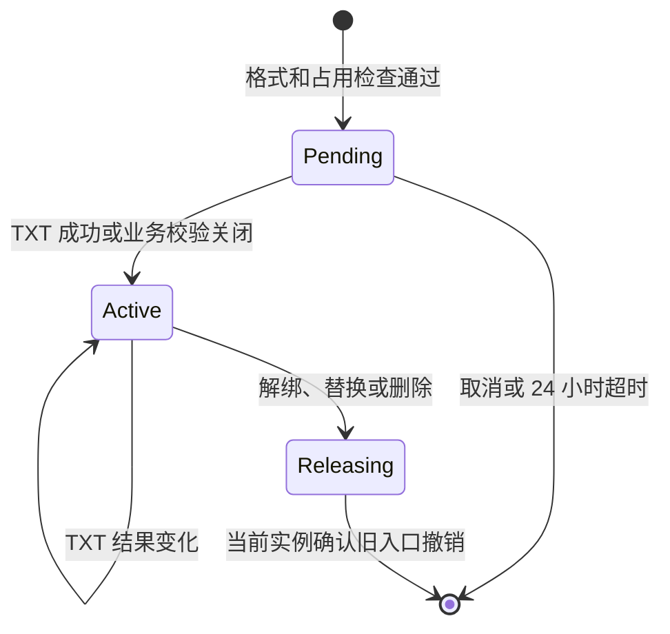

# 公开访问、自定义域名与 HTTP/HTTPS

本章定义公开 Pages 的地址、请求路由、自定义域名和业务 TXT 条件。证书取得与保存见[证书章节](certificates.md)，实例同步和结果字段见[通信章节](communication.md)。

## 网站访问范围

当前 Pages 只有公开访问方式。源码仓库可以是私有的，但启用后网站对所有访客公开；网站请求不读取 Gitea 登录 Cookie，也不查询仓库读取权限。公开仓库改为私有时站点自动关闭，管理员重新启用时再次确认网站公开。

### 实现验收点

- 新站点默认关闭，启用操作明确说明网站公开。
- 私有源码启用 Pages 时网站不自动继承仓库权限。
- 网站请求不读取 Gitea 会话、不访问 Gitea，也不因首次请求创建同步任务。
- 公开转私有会关闭站点，重新启用需要明确操作。

## 公开访问与请求处理

Pages 使用实际请求的 Host 和路径选择本机路由。请求不根据代理转发的 Host 或协议头推导站点；前置代理需要把原始 Host 保持到 Pages。路径规范化后始终限制在当前内容目录，安全的站点内相对符号链接也要再次检查最终目标。

默认 Host 先匹配完整项目路径段，再匹配所有者的主页；自定义 Host 直接选择唯一绑定的站点。关闭、未部署或没有完整内容的站点返回平台 404。项目路径优先于主页，关闭项目不会通过主页同名目录读取项目文件。

`GET` 和 `HEAD` 提供静态内容，其他方法返回 `405`。项目路径缺少末尾斜杠时返回保留查询串的 `308`；目录存在 `index.html` 时读取该文件，不提供目录列表。归档不要求首页文件，因此没有 `index.html` 的目录返回 404，归档中的普通文件仍可按完整路径访问。未知 Host 返回普通 404；磁盘故障返回 503。`standalone` 可以使用网站自己的 `404.html`，Nginx 使用平台错误页。

当前内容目录是已经检查的不可变快照。发布器确认新入口后核心才保存当前摘要并清理旧快照；Nginx 模式在入口事务内原子切换 `current` 链接。路由键包含规范 Host、基础路径和仓库 ID，旧仓库清理只处理仍属于自己的键；同名新仓库不会被迟到清理撤销。

公开内容发送 `X-Content-Type-Options: nosniff` 和重新验证缓存头，平台错误使用 `no-store`。两个服务模式使用一致的路径边界和 404 语义。

### 实现验收点

- 请求只使用本机路由和文件，首次访问不会触发同步、下载或展开。
- 项目完整路径优先匹配，关闭项目不会从主页同名目录读取内容。
- 路由和目录同时核对仓库 ID，改名、转移和同名仓库重建不会误删新入口。
- 路径、符号链接和发布器使用的内容引用都限制在站点目录，半成品不可访问。
- GET/HEAD、斜杠规范、平台 404、网站 404 和 503 具有明确行为。
- 没有 `index.html` 的网站仍可发布并访问实际文件，目录请求返回 404。

## 默认地址与主页

默认地址采用 GitHub Pages 的外部形式。实例登记一个根地址，地址由当前所有者和仓库名称计算：

| 仓库 | 地址 |
| --- | --- |
| `alice/.pages` | `https://alice.<实例域名>/`，所有者主页。 |
| `alice/docs` | `https://alice.<实例域名>/docs/`，项目站点。 |

`.pages` 按当前 `LowerName` 自动成为主页，不保存额外主页标记。普通仓库路径为 `/<repo-lower-name>/`。改名、所有者改名和实际转移立即更新外部路由；仓库 ID、TAR.GZ、本机目录和自定义域名继续属于同一站点。

所有者标签按 Gitea 名称规则转换为合法 DNS 标签，编码必须可逆且避免名称碰撞；仓库名作为单个 URL 路径段。完整 Host 超过 DNS 限制时只报告该站点默认地址错误，仓库改名和自定义域名仍可继续。

默认域名与 Gitea 管理域的命名空间由实例登记时检查。部署者需要注意共享可注册父域可能共享浏览器 Cookie 和 SameSite 信任范围；需要隔离时使用独立可注册域名。这个部署风险不改变站点路由规则。

### 实现验收点

- `.pages` 提供所有者根路径，普通仓库提供项目路径，用户和组织规则一致。
- 同一站点在每个实例使用该实例自己的协议和域名。
- 改名、转移和所有者改名更新外部地址，但不创建第二份站点内容。
- 名称转换可重复、可逆且无碰撞；完整 Host 超限有明确错误。
- 实例登记保护 Gitea 管理 Host、实例默认域名和其生成的命名空间。

## 名称规范化与内部身份

所有者地址使用 `LowerName`。合法 DNS 标签保持可读；点号、下划线和可能造成编码歧义的名称使用固定可逆编码，并保证结果满足单标签 63 字节限制。显示名称不参与地址计算。

仓库 ID 用于 Pages 目录、状态和清理；当前名称只用于外部 Host 和 URL 路径。网站文件路径保持大小写敏感，仓库路径段按 Gitea 的小写名称匹配。

### 实现验收点

- `a-b`、`a.b`、`a_b` 和保留编码前缀名称得到不同地址。
- 名称按 `LowerName` 处理，显示昵称不会改变地址。
- 地址超限只影响对应默认地址并产生稳定错误码。
- Pages 使用仓库 ID 关联目录和结果，名称变化不会复制或混淆内容。

## 自定义域名

自定义 Host 绑定一个仓库 ID，从 `/` 提供该站点。主页的自定义域名只提供主页仓库内容，不继承到其他项目。输入按 IDNA 查询规则转换为实际 DNS 使用的 ASCII 小写名称，同时检查单个标签和完整名称的 DNS 长度；只接受至少包含两个标签的域名，末尾根点、协议、端口、路径、IP 和通配符返回字段错误。这样 Unicode 输入、DNS 查询和 Pages 路由使用同一个名称，也不会因为隐式改写产生重复绑定或证书名称差异。

规范化 Host 在 Gitea 全局唯一，待验证、当前使用和正在释放的绑定都占用名称。Gitea 管理 Host、实例默认域名及其父子域关系受平台命名空间保护。一个站点同时只有一个当前绑定，以及一次待验证或释放操作；操作未完成时返回明确忙碌错误。

申请先进入 `pending`，TXT 成功或全局业务 TXT 关闭后成为 `active`。解绑或替换进入 `releasing`，只有已登记实例都确认旧入口撤销后才释放 Host。未授权申请在 24 小时后释放占用。路由安全释放以入口、挑战和 ACME 维护停止为准；运维只读证书由运维维护。

### 自定义域名绑定状态机

### 实现验收点

- 自定义 Host 按 IDNA 查询规则规范化后全局唯一，标签和完整名称满足 DNS 长度，并拒绝单标签名称、末尾根点、协议、端口、路径、IP 和通配符。
- 自定义 Host 从根路径提供一个站点，主页绑定不覆盖项目站点。
- 一次域名操作完成前，新的替换或释放请求有明确结果。
- 未授权申请在 24 小时后释放，已授权 Host 等待实例确认入口撤销。
- 已成功域名的 TXT 查询失败先进入 24 小时宽限，到期仍失败才关闭入口；绑定归属始终保留，恢复后不会发生域名竞争。

## 业务 TXT 校验与全局配置

Gitea 为每个自定义 Host 生成随机 TXT 值，要求 `_gitea-pages.<host>` 返回该值。Gitea 的计划任务和 Pages 的本机维护循环各自使用可配置周期，默认都是 15 分钟，允许范围为 1 分钟到 24 小时。Gitea 每次实际查询都保存最近校验时间，并在仓库设置页显示该时间；新绑定在第一次查询前显示等待校验。

首次成功前，值不匹配、NXDOMAIN 和临时解析错误都不能激活域名。成功后两端分别保留自己的最近成功时间；后续任何查询失败都在该成功时间后的 24 小时内继续认可现有入口，超过 24 小时仍未恢复才关闭本端发布条件。这个宽限期使短暂 DNS 故障不会立即中断已经发布的网站，同时仍要求长期失效的域名重新证明所有权。查询恢复成功会刷新最近成功时间并重新开放已关闭的入口。

Gitea 的 `[pages] DNS_RESOLVER` 只用于 Gitea 业务 TXT 查询。Pages 的 `GITEA_PAGES_DNS_RESOLVER` 只用于该实例的业务 TXT 查询；两者为空时使用所在系统的解析器。解析器地址和刷新周期是各进程的部署配置，不经同步接口传输，因此不同网络中的实例可以使用各自能够访问的递归 DNS。

全局管理员通过 `app.ini` 的 `[pages] REQUIRE_GITEA_TXT_RECORD` 统一设置这项要求。值为 `false` 时，Gitea 激活待处理域名，Pages 跳过本机业务 TXT 条件；值恢复为 `true` 时，Pages 清除旧的本机 TXT 检查缓存并重新检查带自定义域名的站点。每次站点查询响应都携带当前要求，Pages 确认同一轮分页取值一致后保存并应用。ACME 的 HTTP-01/DNS-01 仍必须向 CA 完成域名控制验证。

### 实现验收点

- Gitea 和 Pages 分别按自己的解析器和刷新周期执行 TXT 查询，默认周期为 15 分钟。
- 每次 Gitea 查询都更新最近校验时间；首次查询前和已经查询过的状态在仓库页面可以区分。
- 从未成功的域名不能激活；已经成功的域名在任一类查询失败后的 24 小时内继续发布，到期仍失败才关闭对应入口。
- Gitea 启动配置同时作用于两端，每次同步响应携带当前布尔值，分页中的值必须一致。
- 业务 TXT 不取代 ACME 向 CA 的域名控制验证。
- DNS 临时错误和明确不匹配有稳定状态，最近成功时间在失败时保留，恢复后刷新并重新开放入口。

## HTTPS 与内容开放条件

HTTP 实例直接提供 HTTP。HTTPS 实例的自定义域名必须同时满足当前内容、路由标记、业务 TXT、有效证书和真实 TLS/SNI/Host/路径探测；默认地址只需要自己的内容、路由和证书条件。某个实例或自定义域名失败不影响其他地址。

HTTP-01 挑战路径由 Pages 单独管理，直接返回准确正文，不从网站目录读取。普通 HTTP 请求可以按当前实例策略跳转 HTTPS，挑战路径不跳转。实例根域的固定平台探测用于确认入口配置，网站文件不能覆盖平台路径。

Pages 先检查 Nginx 候选配置，执行 reload，再通过真实 Host、端口、SNI 和路径探测入口；三步都成功后才写入配置确认和地址发布状态。证书文件加载也由实际 TLS 探测确认。Pages 进程停止时 Nginx 可以保持最后成功配置，恢复后重新检查当前条件。

### 实现验收点

- HTTP 地址在内容和路由实际生效后开放；HTTPS 地址还要求证书和 TLS 探测。
- 默认地址、自定义地址和不同实例的结果分别记录。
- HTTP-01 挑战直接返回正文，不依赖网站目录或未签发证书。
- Nginx 配置经过测试、重载和真实入口探测后才报告发布成功。
- Gitea 显示稳定错误原因，证书材料和 ACME 执行细节留在 Pages。

## 域名变更与解绑

新 Host 授权前旧 Host 保持当前状态。新 Host 成为 `active` 后，Gitea 在一个事务中切换站点当前绑定并把旧 Host 设为 `releasing`。Pages 取得新状态后按仓库 ID 清理多出的旧路由、挑战和续期，再应用新 Host；新 Host 失败不会恢复旧 Host，默认地址继续独立工作。

Gitea 使用站点当前时间和每个实例根地址时间判断旧 Host 是否已经从配置中移除。所有登记实例都确认 `config_applied=true` 后释放；永久故障实例由管理员先隔离入口，再移除登记。释放依赖入口、挑战和 ACME 维护停止；Pages 清理自己的 ACME 材料和 Nginx 生成副本，运维只读证书由运维维护，不参与域名释放条件。

### 实现验收点

- 域名切换在一个事务中更新当前绑定和站点时间。
- 每个实例按仓库 ID 撤销旧入口，并分别报告配置落实和新地址结果。
- 新 Host 失败时旧 Host 不恢复，默认地址不受影响。
- Gitea 只在当前实例都确认旧入口撤销，或故障实例已隔离并移除后释放旧 Host。
- 本机残留清理按绑定 ID 进行，不会重新开放已释放的 Host。
