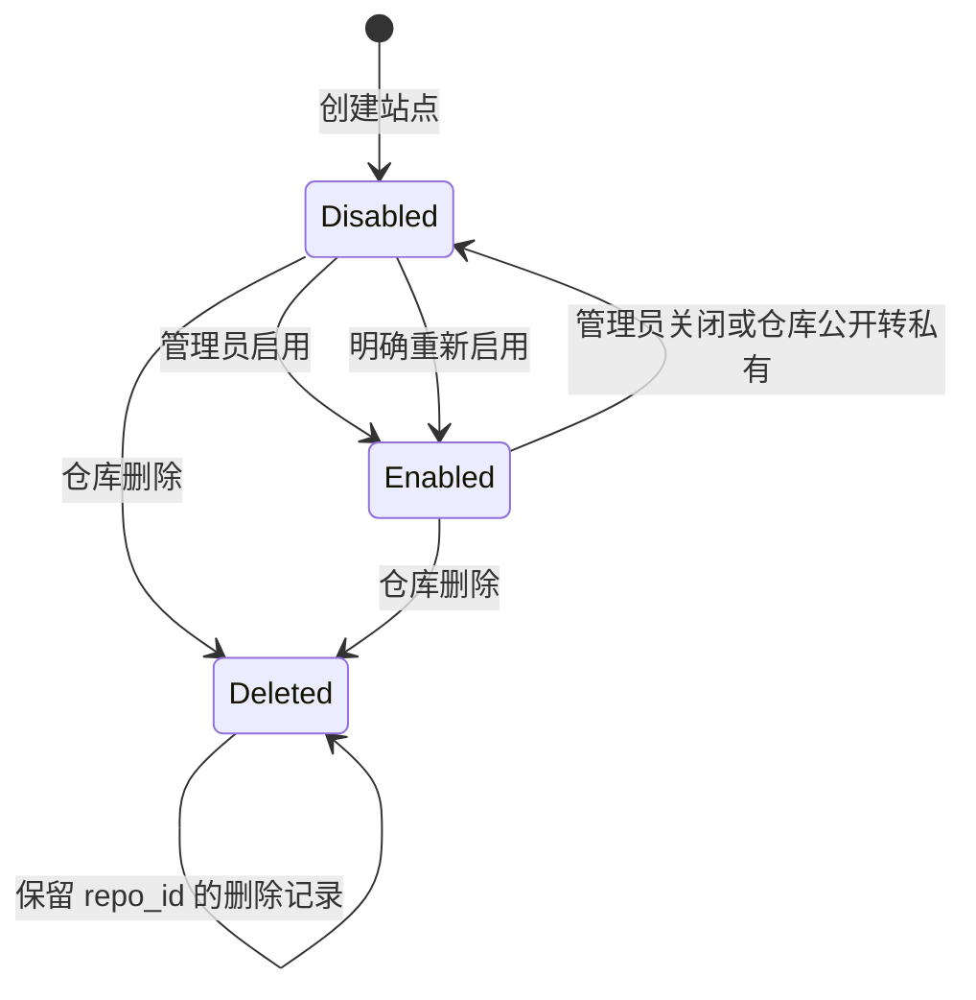

# 实例与站点生命周期

本章定义 Gitea 当前事实如何变化，以及 Pages 实例如何按当前事实收敛。实例结果表示当前状态；发布和通信的字段含义分别见[发布章节](publishing.md)和[通信章节](communication.md)。

## 实例登记与移除

全局管理员登记 Pages 实例并注入实例凭据和根地址。Gitea 校验根地址格式、管理域冲突、实例默认域名命名空间以及证书和 DNS-01 所需的派生名称，再保存实例。实例注册成功后主动查询全部当前状态并部署所有启用站点。

每个实例独立运行在一台机器上，使用自己的单成员内嵌 etcd、数据根目录和 HTTPS 责任模式。Gitea 不为站点选择某台实例；所有实例都处理同一站点集合。管理员移除实例前先隔离其实际入口，随后即可删除登记；这使域名释放和删除清理继续依赖仍登记实例的确认。

移除可以是最后一个登记实例。管理员完成入口隔离后即可执行，不增加全局 Pages 停用状态；已经进入 `releasing` 的域名由 Gitea 按现有释放事实继续完成释放，最后实例移除不会让待释放域名永久保留。

### 实现验收点

- 新实例只在根地址和命名空间检查通过后参与同步和域名释放条件。
- 实例注册幂等，根地址变化产生新的实例时间并要求本地重新应用。
- 所有实例主动处理全部启用站点，不保存单实例部署选择。
- 管理员先隔离入口后可以移除最后实例；移除后不增加全局停用状态，待释放域名继续完成释放。

## 站点创建、启用与来源

仓库首次保存 Pages 设置或首次上传成品时创建一条 `pages_site`，默认 `enabled=false`。首次上传自动选择 `artifact` 发布方式；设置页面可以选择“Actions 或上传”与“分支目录”两种自动发布方式。网页/API 上传属于版本操作，在任一方式下都可以把经过检查的 TAR.GZ 设为当前版本，同时保留自动发布配置。这样管理员可以紧急发布一个明确版本，分支后续只有出现新提交时才继续自动更新。

启用时 Gitea 检查来源配置和仓库状态，推进站点更新时间。没有当前成品时可以保存启用意图，但实例保持平台 404，直到成品准备完成。来源失败只更新来源错误，不覆盖当前成品；来源切换时旧候选失效，实例按最新当前事实处理。

### 站点管理状态机

### 实现验收点

- 每个仓库最多一条站点记录，首次设置或上传创建后默认关闭。
- 启用、关闭、来源变更和当前版本变化推进站点时间；相同当前摘要的重复提交保持时间不变。
- 启用无成品时实例返回平台 404；成品准备成功后主动部署。
- 来源错误、当前版本和实例结果相互独立。
- 手动上传在任一自动发布方式下都可用，并保持来源配置和分支处理进度。

## 关闭、重新启用与删除

关闭站点时 Gitea 设置 `enabled=false` 并推进站点时间。Pages 撤销站点路由；HTTPS 实例同时停止该站点的自定义域名挑战和续期。Gitea 保留当前成品和域名管理事实，页面显示实例配置是否已经落实。重新启用只处理最后当前状态，快速关闭再启用不会要求完成一个已经被新状态取代的中间状态。

删除仓库沿用仓库工作锁和删除事务，把站点压缩为永久删除记录：保留 `repo_id`、删除标记和更新时间，清空来源、来源错误和当前版本指针；同一事务删除该仓库全部版本引用，并把摘要列表交给事务后的 storage 清理。这样仓库事务回滚时对象仍有引用，提交成功后又能一次清理当前和历史版本。实例收到删除记录后先撤销路由、挑战和续期，再清理目录并上报配置落实。待释放域名由实例确认后释放；Pages 本机物理文件清理由实例继续重试。

关闭或删除后的旧目录不能被同名新仓库复用。路由和清理都核对 `repo_id`，新仓库使用新的 ID。

### 实现验收点

- 关闭状态停止站点入口并停止对应证书/挑战维护，当前成品仍可由管理面查询。
- 重新启用处理最后当前状态，页面不会虚构中间关闭已全部完成。
- 删除事务保留精简 `repo_id` 记录，在事务内清除全部版本引用，并在提交后清理 Gitea storage 对象。
- 待验证域名可以直接释放，已授权域名进入 `releasing` 并等待实例确认。
- 同名新仓库的路由、目录和启用标记不会被旧删除清理影响。

## 仓库归档、改名、转移与新仓库派生

仓库改名、所有者改名和实际转移只改变外部地址和路由，推进站点更新时间；仓库 ID、当前及历史版本、本机目录和自定义域名绑定继续属于原站点。`.pages` 用途按当前仓库名自动变化，改为 `.pages` 成为主页，改离 `.pages` 成为项目站点。

Pages 按仓库 ID 撤销当前配置中不存在的旧路由，再建立新路由；网站文件不由 Gitea 改写，绝对地址由来源构建流程负责。待验证和已授权的自定义域名绑定都随站点 ID 保留，转移只更新站点归属和路由事实。

仓库归档会关闭 Pages 站点并推进站点时间，解档后也保持关闭，管理员需要明确重新启用；已经保存的成品和域名事实按关闭流程保留。派生、模板生成、外部导入和收养 Git 仓库创建新的仓库 ID，Pages 默认关闭且不复制来源、成品、域名或结果。镜像同步保留原 ID，只触发分支来源重新检查。

### 实现验收点

- 改名和实际转移推进站点时间并更新地址，内容和已授权域名保持关联。
- `.pages` 用途完全由当前名称推导，显示昵称和转移申请不改变地址。
- 旧路由清理按仓库 ID 进行，不能撤销同名新仓库。
- 待验证和已授权域名都随站点 ID 转移，转移后的当前站点继续使用同一绑定事实。
- 归档会关闭 Pages，解档后仍保持关闭，管理员明确重新启用后才恢复发布；派生和导入仓库获得新 ID、默认关闭且不复制 Pages 数据。

## 自定义域名变更与释放

新 Host 通过 TXT 授权后，Gitea 在一个事务中把它设为当前绑定、把旧 Host 设为 `releasing` 并推进站点时间。Pages 取得新状态后按仓库 ID 撤销旧路由、挑战和续期，再应用新 Host；新 Host 失败不会恢复旧 Host，默认地址继续独立服务。

旧 Host 释放要求每个已登记实例在当前站点时间和当前根地址时间下报告 `config_applied=true`。新登记实例完成全部查询、刚改根地址的实例完成重新应用前都参与条件。永久故障实例由运维先隔离实际入口，再移除登记。释放只确认入口已撤销，证书和文件残留由 Pages 按绑定 ID 继续清理。

### 实现验收点

- 域名切换原子更新当前绑定、释放旧绑定并推进站点时间。
- 每个实例按仓库 ID 清理旧绑定，并分别报告配置落实和新地址结果。
- 旧 Host 释放不会等待物理文件删除，但必须确认入口、挑战和续期已停止。
- 新实例、改址实例和永久故障实例分别按当前状态进入或退出释放条件。
- 清理按绑定 ID 进行，不会重新开放已经释放的 Host。

## 失联、重建与永久故障

Gitea 暂时失联时，Pages 使用最后确认的本机状态继续提供公开网站，并继续本机 TXT、证书和清理维护。内置 Web 服务随 Pages 进程停止；使用前置代理时，代理本身仍可运行，但源站不可用。恢复后从 etcd 游标继续同步并重新核对当前条件。

本地 etcd 无法读取、游标超前或 Gitea 数据库恢复后现有游标已不能表示当前数据时，运维停止 Pages、清空 YAML 中 `pages.data_root` 指定的数据根目录，再使用原有实例凭据启动。空状态从首次全部查询、补查和主动部署开始，通信凭据仅表示实例身份，不影响同步起点。

失联期间同名新仓库可以暂时命中旧内容；恢复同步后先按旧 `repo_id` 撤销旧路由，新仓库部署成功后再开放相同外部路径，否则返回平台 404。永久故障实例先隔离真实入口，再从 Gitea 移除登记，其他实例和当前成品不受影响。

### 实现验收点

- Gitea 失联时已确认网站继续服务，Pages 本机证书和 TXT 维护不依赖管理请求。
- Gitea 失联与 Pages 进程停止是两种状态：前者继续使用本机确认内容，后者停止内置源站。
- 状态损坏、游标超前和数据库恢复都通过清空本机数据根目录触发首次全部查询，实例凭据保持不变。
- 清空目录后从空配置开始，按 Gitea 返回的时间和仓库 ID 顺序重建，未部署站点返回平台 404。
- 永久故障实例先隔离入口再移除登记，其他实例和 Gitea 当前成品保持可用。
